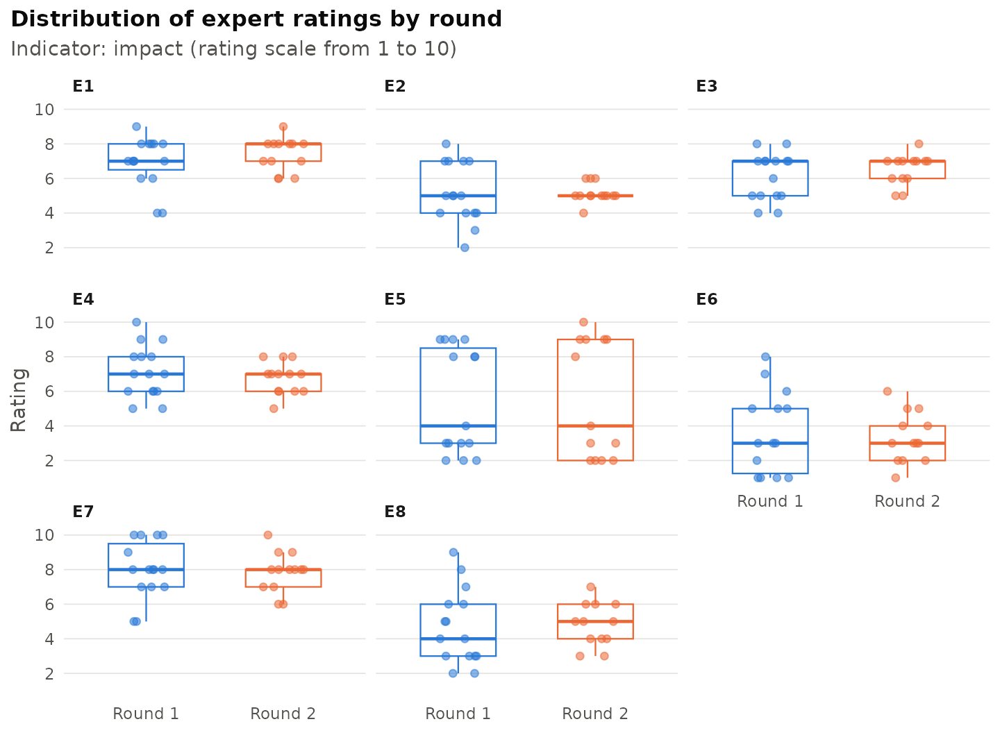
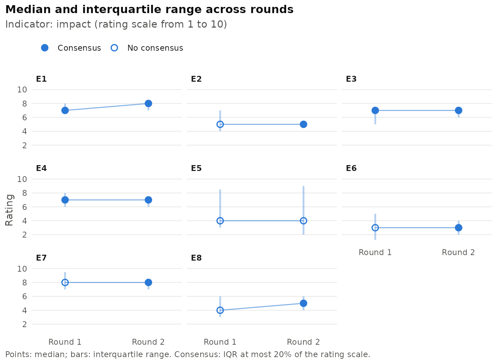
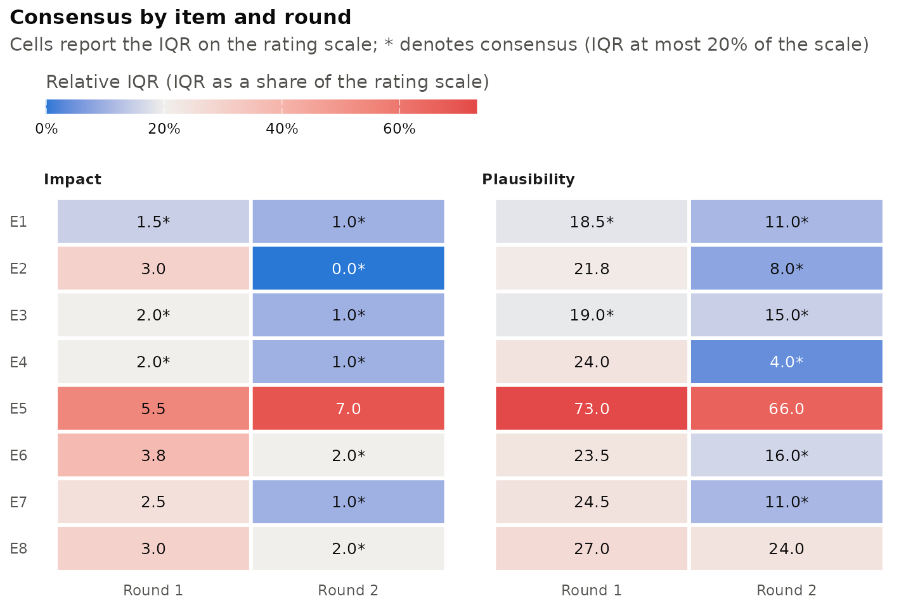
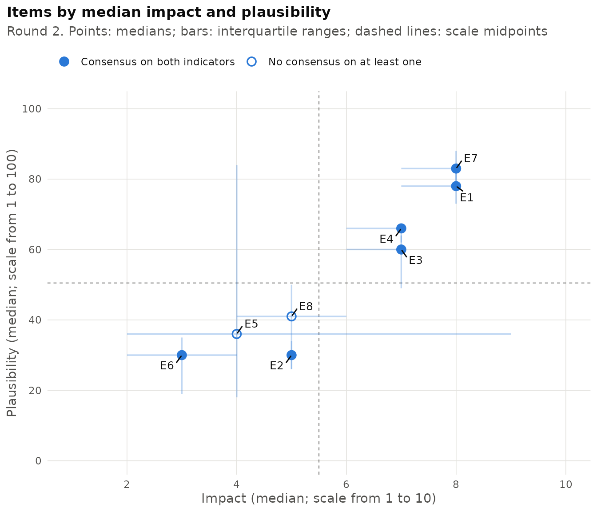
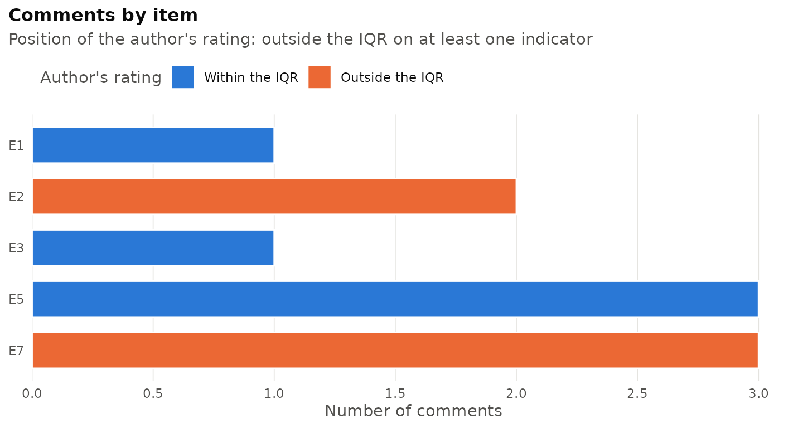

# Introduction to DelphiR

The Delphi method elicits the judgements of a panel of experts through
successive rounds of anonymous rating, interleaved with controlled
feedback on the distribution of the group’s responses. The analysis of
each round typically addresses four questions: how the ratings are
distributed, whether the panel has reached consensus, whether the
ratings have stabilised between rounds, and which items should be
submitted to a further round. DelphiR provides a consistent workflow for
these steps, from the import of the raw ratings to a complete round
report.

``` r

library(DelphiR)
```

## Data format

DelphiR is built around a wide layout: each row contains the ratings
given by one expert, each column refers to one item, and each cell holds
a numeric rating. Empty cells denote missing ratings (item
non-response).

| expert | round | indicator | E1  | E2  | E3  |
|--------|-------|-----------|-----|-----|-----|
| EXP01  | 1     | impact    | 9   | 7   | 5   |
| EXP02  | 1     | impact    | 6   | 5   | 7   |
| EXP03  | 1     | impact    | 8   |     | 6   |

Three columns describe the context of each row:

- the expert identifier, which is required to follow the same expert
  across rounds;
- the round number (1, 2, …);
- the indicator, such as impact or plausibility, when the same items are
  rated on more than one dimension.

The round and indicator columns are optional. When they are absent, the
table is treated as a single round and a single indicator, specified
through the `round` and `indicator` arguments. Each indicator has its
own rating scale, against which the ratings are validated.

[`delphi_template()`](https://yuricalleo.github.io/DelphiR/reference/delphi_template.md)
creates an empty Excel file in this format, with a sheet for the
ratings, a sheet for the full statements of the items and a sheet of
instructions that includes the code needed to import the completed file.

``` r

delphi_template("my_delphi.xlsx", items = 12,
                indicators = c("impact", "probability"))
```

## Importing the ratings

Ratings can be imported from a data frame with
[`delphi_data()`](https://yuricalleo.github.io/DelphiR/reference/delphi_data.md)
or directly from a CSV, TSV or Excel file with
[`read_delphi()`](https://yuricalleo.github.io/DelphiR/reference/read_delphi.md).
The separator and the decimal mark of text files are detected
automatically, including the semicolon-separated files with decimal
commas produced by many European spreadsheet applications.

``` r

path <- system.file("extdata", "delphi_round1.csv", package = "DelphiR")
r1 <- read_delphi(path, expert_col = "expert",
                  indicator = "impact", scale = c(1, 10))
r1
#> <delphi_data>
#>   Experts:    15
#>   Rounds:     1 (1)
#>   Items:      8 (E1, E2, E3, E4, E5, ..., E8)
#>   Indicators: impact (from 1 to 10)
#>   Ratings:    119 (1 missing)
#> Use summary() for descriptive statistics.
```

Tables referring to different rounds or indicators can be imported
separately and combined with
[`delphi_bind()`](https://yuricalleo.github.io/DelphiR/reference/delphi_bind.md),
for example `delphi_bind(r1, r2)`. Alternatively, rounds and indicators
can be stacked in a single table, as in the example dataset shipped with
the package, in which fifteen experts rated eight items on impact (from
1 to 10) and plausibility (from 1 to 100) over two rounds.

``` r

head(delphi_example)
#>   expert round indicator E1 E2 E3 E4 E5 E6 E7 E8
#> 1  EXP01     1    impact  9  7  5 10  3  1  5  6
#> 2  EXP02     1    impact  6  5  7  9  9  7 10  2
#> 3  EXP03     1    impact  8  5  6  7  3 NA  8  8
#> 4  EXP04     1    impact  8  3  7  9  8  3 10  3
#> 5  EXP05     1    impact  7  5  7  8  2  5  5  3
#> 6  EXP06     1    impact  4  4  8  5  8  1  8  2

x <- delphi_data(
  delphi_example,
  expert_col = "expert", round_col = "round", indicator_col = "indicator",
  scale = list(impact = c(1, 10), plausibility = c(1, 100))
)
x
#> <delphi_data>
#>   Experts:    15
#>   Rounds:     2 (1, 2)
#>   Items:      8 (E1, E2, E3, E4, E5, ..., E8)
#>   Indicators: impact (from 1 to 10), plausibility (from 1 to 100)
#>   Ratings:    445 (3 missing)
#> Use summary() for descriptive statistics.
```

Ratings outside the declared scale, non-numeric entries and duplicated
experts are reported with an informative error, so that coding mistakes
are detected before any analysis is carried out. Rows without an expert
identifier, such as summary rows with medians or quartiles added below
the data, are ignored with a warning.

### Long format

Ratings can also be supplied in long format, with one row per rating and
columns for the expert, the item and the value, and optionally the round
and the indicator. This is the format produced by most statistical
software when data are reshaped. Long tables are imported with
[`delphi_data_long()`](https://yuricalleo.github.io/DelphiR/reference/delphi_data_long.md)
or with `read_delphi(layout = "long")`, and any `delphi_data` object can
be returned to this format with
[`as.data.frame()`](https://rdrr.io/r/base/as.data.frame.html).

``` r

long <- as.data.frame(x)
head(long)
#>   expert round indicator item value
#> 1  EXP01     1    impact   E1     9
#> 2  EXP02     1    impact   E1     6
#> 3  EXP03     1    impact   E1     8
#> 4  EXP04     1    impact   E1     8
#> 5  EXP05     1    impact   E1     7
#> 6  EXP06     1    impact   E1     4
x_long <- delphi_data_long(
  long, round_col = "round", indicator_col = "indicator",
  scale = list(impact = c(1, 10), plausibility = c(1, 100))
)
identical(x_long$data, x$data)
#> [1] TRUE
```

### Survey exports with two header rows

When each item is rated on several indicators, survey platforms and
spreadsheets often place the indicators side by side, with a first
header row naming the indicator of each column and a second row giving
the item statement above each group of columns:

|     |     | Impact              | Probability | Impact               | Probability |
|-----|-----|---------------------|-------------|----------------------|-------------|
| ID  | Age | 1\. First statement |             | 2\. Second statement |             |
| 11  | 30  | 8                   | 6           | 5                    | 4           |

Such files are read with `header_rows = 2`. Items are coded `E1`, `E2`,
… in order of appearance, their statements are stored as labels and used
in reports, and columns without an indicator (such as `Age`) are
ignored. Indicator names can be translated or shortened with
`indicator_names`.

``` r

r1 <- read_delphi(
  "study.xlsx", sheet = "ROUND_1", header_rows = 2,
  expert_col = "ID", round = 1, scale = c(1, 10),
  indicator_names = c(IMPATTO = "impact", PROBAB = "probability")
)
```

### Linked and unlinked panels

Comparisons between rounds at the level of the individual expert require
that the same expert has the same identifier in every round. This is not
the case when each round is collected with a separate questionnaire and
the identifiers are response numbers: the same number then denotes
different people. Declaring `linked = FALSE` prevents spurious pairings:
retention is not computed, and stability is assessed by comparing the
rounds as independent samples (see below). Tables imported without an
expert identifier are treated as unlinked.

## Descriptive statistics and panel participation

[`summary()`](https://rdrr.io/r/base/summary.html) gives an overview of
the panel and of the median and interquartile range (IQR) of each item
by round. Items that reach consensus are marked with an asterisk.

``` r

summary(x)
#> Delphi study summary
#> 
#> Panel
#>  round respondents retained dropped joined retention
#>      1          15       NA      NA     NA      100%
#>      2          13       13       2      0       87%
#> 
#> Indicator: impact (scale from 1 to 10)
#> Median [IQR] by round (* = consensus)
#>    Round 1   Round 2
#> E1 7 [1.5] * 8 [1] *
#> E2 5 [3]     5 [0] *
#> E3 7 [2] *   7 [1] *
#> E4 7 [2] *   7 [1] *
#> E5 4 [5.5]   4 [7]  
#> E6 3 [3.75]  3 [2] *
#> E7 8 [2.5]   8 [1] *
#> E8 4 [3]     5 [2] *
#> 
#> Indicator: plausibility (scale from 1 to 100)
#> Median [IQR] by round (* = consensus)
#>    Round 1     Round 2  
#> E1 77 [18.5] * 78 [11] *
#> E2 28 [21.75]  30 [8] * 
#> E3 62 [19] *   60 [15] *
#> E4 63 [24]     66 [4] * 
#> E5 30 [73]     36 [66]  
#> E6 30 [23.5]   30 [16] *
#> E7 80 [24.5]   83 [11] *
#> E8 40 [27]     41 [24]  
#> 
#> Consensus rule: IQR <= 20% of the scale.
#> Full tables: delphi_describe(x), delphi_consensus(x).
```

[`delphi_describe()`](https://yuricalleo.github.io/DelphiR/reference/delphi_describe.md)
returns the full set of descriptive statistics, and
[`delphi_panel()`](https://yuricalleo.github.io/DelphiR/reference/delphi_panel.md)
the number of respondents and the retention rate in each round.

``` r

head(delphi_describe(x, indicator = "impact"))
#>  indicator round item  n missing mean   sd median   q1  q3  iqr iqr_rel min max
#>     impact     1   E1 15       0 6.93 1.44      7 6.50 8.0 1.50    0.15   4   9
#>     impact     1   E2 15       0 5.13 1.73      5 4.00 7.0 3.00    0.30   2   8
#>     impact     1   E3 15       0 6.13 1.36      7 5.00 7.0 2.00    0.20   4   8
#>     impact     1   E4 15       0 7.13 1.51      7 6.00 8.0 2.00    0.20   5  10
#>     impact     1   E5 15       0 5.47 3.07      4 3.00 8.5 5.50    0.55   2   9
#>     impact     1   E6 14       1 3.64 2.37      3 1.25 5.0 3.75    0.38   1   8
#>    cv
#>  0.21
#>  0.34
#>  0.22
#>  0.21
#>  0.56
#>  0.65
delphi_panel(x)
#>   round respondents retained dropped joined retention
#> 1     1          15       NA      NA     NA 1.0000000
#> 2     2          13       13       2      0 0.8666667
```

Quartiles are computed with R’s default algorithm (`type = 7`). Setting
`type = 6` reproduces the quartiles reported by SPSS and Minitab, which
facilitates comparison with studies analysed with that software.

## Consensus

Following the review of consensus measures by von der Gracht (2012), an
item is considered to have reached consensus when its IQR does not
exceed 20% of the rating scale. By default, the scale is measured by its
number of points, so that the threshold corresponds to an IQR of at most
1 on a five-point scale and at most 2 on a ten-point scale. The
threshold can be changed with `threshold`, and `relative_to = "range"`
measures the scale as its maximum minus its minimum, which is preferable
for continuous scales.

``` r

cons <- delphi_consensus(x, round = 2)
cons
#> Consensus rule: IQR <= 20% of the scale (number of points)
#> 
#>     indicator round item  n median q1 q3 iqr iqr_rel iqr_max consensus
#>        impact     2   E1 13      8  7  8   1    0.10       2      TRUE
#>        impact     2   E2 13      5  5  5   0    0.00       2      TRUE
#>        impact     2   E3 13      7  6  7   1    0.10       2      TRUE
#>        impact     2   E4 13      7  6  7   1    0.10       2      TRUE
#>        impact     2   E5 13      4  2  9   7    0.70       2     FALSE
#>        impact     2   E6 13      3  2  4   2    0.20       2      TRUE
#>        impact     2   E7 13      8  7  8   1    0.10       2      TRUE
#>        impact     2   E8 12      5  4  6   2    0.20       2      TRUE
#>  plausibility     2   E1 13     78 73 84  11    0.11      20      TRUE
#>  plausibility     2   E2 13     30 26 34   8    0.08      20      TRUE
#>  plausibility     2   E3 13     60 49 64  15    0.15      20      TRUE
#>  plausibility     2   E4 13     66 62 66   4    0.04      20      TRUE
#>  plausibility     2   E5 13     36 18 84  66    0.66      20     FALSE
#>  plausibility     2   E6 13     30 19 35  16    0.16      20      TRUE
#>  plausibility     2   E7 13     83 77 88  11    0.11      20      TRUE
#>  plausibility     2   E8 13     41 26 50  24    0.24      20     FALSE
#> 
#> Items with consensus:
#>   impact, round 2: 7 of 8
#>   plausibility, round 2: 6 of 8
```

## Stability

Consensus describes the agreement of the panel within a round; stability
describes whether the ratings have ceased to change between rounds. When
the experts are linked across rounds,
[`delphi_stability()`](https://yuricalleo.github.io/DelphiR/reference/delphi_stability.md)
compares consecutive rounds on the experts who rated the item in both,
so that attrition is not mistaken for a change of opinion. Two criteria
are available: the Wilcoxon test (the default), under which an item is
stable when the test is not significant, and a criterion based on
Scheibe, Skutsch and Schofer (1975), under which an item is stable when
the net change between the two rating distributions does not exceed 15%.
The net change is half the sum of the absolute differences between the
shares of experts in each class of the scale, that is, the share of
experts who would have to move to turn one distribution into the other.
Setting `method = "both"` requires both conditions. With linked experts
the Wilcoxon test is the paired signed-rank test; with unlinked experts
the rounds are compared as independent samples with the rank-sum
(Mann-Whitney) test, and differences between rounds then reflect both
changes of opinion and changes in the composition of the panel.

``` r

delphi_stability(x, indicator = "impact")
#> Stability criterion: Wilcoxon signed-rank test, stable if p >= 0.05
#> Paired comparison on the experts who answered both rounds.
#> 
#>  indicator item round_from round_to n_paired median_from median_to iqr_from
#>     impact   E1          1        2       13           7         8     1.50
#>     impact   E2          1        2       13           5         5     3.00
#>     impact   E3          1        2       13           7         7     2.00
#>     impact   E4          1        2       13           7         7     2.00
#>     impact   E5          1        2       13           4         4     5.50
#>     impact   E6          1        2       12           3         3     3.75
#>     impact   E7          1        2       13           8         8     2.50
#>     impact   E8          1        2       12           4         5     3.00
#>  iqr_to changed p_value scheibe_change stable
#>       1    0.62    0.10           0.23   TRUE
#>       0    0.69    0.85           0.62   TRUE
#>       1    0.46    0.13           0.31   TRUE
#>       1    0.62    0.41           0.23   TRUE
#>       7    0.23    0.77           0.15   TRUE
#>       2    0.67    0.52           0.42   TRUE
#>       1    0.62    0.53           0.31   TRUE
#>       2    0.83    0.64           0.33   TRUE
#> 
#> Stable items:
#>   impact, round 1 to 2: 8 of 8
#> All columns: as.data.frame(x).
```

## Item status and the next round

[`delphi_status()`](https://yuricalleo.github.io/DelphiR/reference/delphi_status.md)
combines consensus and stability into four categories: *consensus*
(consensus reached and stable), *unstable consensus* (consensus reached,
but ratings still changing), *stable dissent* (no consensus, but ratings
no longer changing) and *open* (neither). Items with an unstable
consensus or an open status are flagged for a further round. A stable
dissent is a substantive result: it indicates a persistent disagreement
that a further round is unlikely to resolve.

``` r

st <- delphi_status(x)
st
#>     indicator item round median iqr consensus stable             status
#>        impact   E1     2      8   1      TRUE   TRUE          consensus
#>        impact   E2     2      5   0      TRUE   TRUE          consensus
#>        impact   E3     2      7   1      TRUE   TRUE          consensus
#>        impact   E4     2      7   1      TRUE   TRUE          consensus
#>        impact   E5     2      4   7     FALSE   TRUE     stable dissent
#>        impact   E6     2      3   2      TRUE   TRUE          consensus
#>        impact   E7     2      8   1      TRUE   TRUE          consensus
#>        impact   E8     2      5   2      TRUE   TRUE          consensus
#>  plausibility   E1     2     78  11      TRUE   TRUE          consensus
#>  plausibility   E2     2     30   8      TRUE   TRUE          consensus
#>  plausibility   E3     2     60  15      TRUE   TRUE          consensus
#>  plausibility   E4     2     66   4      TRUE   TRUE          consensus
#>  plausibility   E5     2     36  66     FALSE   TRUE     stable dissent
#>  plausibility   E6     2     30  16      TRUE   TRUE          consensus
#>  plausibility   E7     2     83  11      TRUE  FALSE unstable consensus
#>  plausibility   E8     2     41  24     FALSE   TRUE     stable dissent
#>  next_round
#>       FALSE
#>       FALSE
#>       FALSE
#>       FALSE
#>       FALSE
#>       FALSE
#>       FALSE
#>       FALSE
#>       FALSE
#>       FALSE
#>       FALSE
#>       FALSE
#>       FALSE
#>       FALSE
#>        TRUE
#>       FALSE
#> 
#> impact, round 2: 7 consensus, 0 unstable consensus, 1 stable dissent, 0 open
#>   Items for the next round: none
#> 
#> plausibility, round 2: 5 consensus, 1 unstable consensus, 2 stable dissent, 0 open
#>   Items for the next round: E7
subset(st, next_round)
#>     indicator item round median iqr consensus stable             status
#>  plausibility   E7     2     83  11      TRUE  FALSE unstable consensus
#>  next_round
#>        TRUE
#> 
#> plausibility, round 2: 0 consensus, 1 unstable consensus, 0 stable dissent, 0 open
#>   Items for the next round: E7
```

## Figures

DelphiR draws four figures with ggplot2, all available through
[`plot()`](https://rdrr.io/r/graphics/plot.default.html). They are
returned as ggplot objects and can therefore be modified with the usual
ggplot2 syntax or saved with
[`ggplot2::ggsave()`](https://ggplot2.tidyverse.org/reference/ggsave.html).

The distribution of the ratings in each round shows how the panel
converges or remains divided.

``` r

plot(x, type = "distribution", indicator = "impact")
```



The median and IQR across rounds summarise the same information; filled
points denote consensus.

``` r

plot(x, type = "trend", indicator = "impact")
```



The consensus heat map displays the relative IQR of every item in every
round, coloured relative to the consensus threshold. Since the relative
IQR does not depend on the scale, indicators rated on different scales
can be shown side by side.

``` r

plot(x, type = "consensus")
```



With two indicators, the items can be mapped by their median ratings, as
in the impact-plausibility matrices used in foresight studies.

``` r

plot(x, type = "map")
```



## Expert comments

Delphi questionnaires usually invite the experts to justify their
ratings in a written comment. DelphiR stores the comments next to the
ratings, so that each comment can be read together with the rating given
by its author. The recommended layout has one row per comment, with the
expert, the round, the item and the text of the comment; an empty item
denotes a general comment on the questionnaire. This is the layout of
the `comments` sheet of the template, which
[`read_delphi()`](https://yuricalleo.github.io/DelphiR/reference/read_delphi.md)
reads with `comments_sheet = "comments"`. Survey platforms that export
one comment column per item are handled by
`delphi_add_comments(layout = "wide")`.

``` r

head(delphi_example_comments, 3)
#>   expert round item
#> 1  EXP01     2   E7
#> 2  EXP10     2   E7
#> 3  EXP13     2   E7
#>                                                                                comment
#> 1 Adoption will be slower than expected, because most firms lack the necessary skills.
#> 2              The technology is already available, and its costs are falling quickly.
#> 3                    New regulation in the European Union will accelerate this change.
#>                  theme
#> 1 skills; time horizon
#> 2                costs
#> 3           regulation
x <- delphi_add_comments(x, delphi_example_comments)
x
#> <delphi_data>
#>   Experts:    15
#>   Rounds:     2 (1, 2)
#>   Items:      8 (E1, E2, E3, E4, E5, ..., E8)
#>   Indicators: impact (from 1 to 10), plausibility (from 1 to 100)
#>   Ratings:    445 (3 missing)
#>   Comments:   11 (round 2); coded with themes
#> Use summary() for descriptive statistics.
```

[`delphi_comments()`](https://yuricalleo.github.io/DelphiR/reference/delphi_comments.md)
lists the comments with the rating of their author on every indicator,
and its position relative to the ratings of the panel: below the first
quartile, within the interquartile range or above the third quartile.
Comments from experts outside the interquartile range present the
arguments of the minority, which the Delphi method asks the rest of the
panel to consider.

``` r

delphi_comments(x, items = "E7", general = FALSE)
#> <delphi_comments> 3 comment(s)
#> 
#> Round 2, item E7
#>   [EXP01]: impact below Q1, plausibility below Q1 (theme: skills; time horizon)
#>     Adoption will be slower than expected, because most firms lack the
#>     necessary skills.
#>   [EXP10]: impact above Q3, plausibility above Q3 (theme: costs)
#>     The technology is already available, and its costs are falling
#>     quickly.
#>   [EXP13]: impact within IQR, plausibility above Q3 (theme: regulation)
#>     New regulation in the European Union will accelerate this change.
```

[`delphi_comment_counts()`](https://yuricalleo.github.io/DelphiR/reference/delphi_comment_counts.md)
counts the comments received by each item, and
`plot(x, type = "comments")` shows them split by the position of their
authors.

``` r

delphi_comment_counts(x)
#>  round item n_comments n_experts n_raters share_experts n_outside
#>      2   E1          1         1       13          0.08         0
#>      2   E2          2         2       13          0.15         2
#>      2   E3          1         1       13          0.08         0
#>      2   E4          0         0       13          0.00         0
#>      2   E5          3         3       13          0.23         0
#>      2   E6          0         0       13          0.00         0
#>      2   E7          3         3       13          0.23         3
#>      2   E8          0         0       13          0.00         0
plot(x, type = "comments")
```



The analysis of the content of the comments remains a task for the
researchers. A common approach is to code each comment with one or more
themes, written in a `theme` column and separated by semicolons;
[`delphi_themes()`](https://yuricalleo.github.io/DelphiR/reference/delphi_themes.md)
then tabulates the themes by item or across items.
[`delphi_words()`](https://yuricalleo.github.io/DelphiR/reference/delphi_words.md)
gives a first, descriptive overview of the words used in the comments,
after removing common English and Italian words.

``` r

delphi_themes(x, by = "theme")
#>   round              theme n_comments n_experts n_outside n_items  items
#> 1     2              costs          2         2         1       2 E3, E7
#> 2     2         regulation          2         2         2       2 E2, E7
#> 3     2       time horizon          2         2         1       1     E7
#> 4     2            wording          2         2         0       2 E1, E5
#> 5     2   current practice          1         1         1       1     E2
#> 6     2 sector differences          1         1         0       1     E5
#> 7     2             skills          1         1         1       1     E7
#> 8     2        uncertainty          1         1         0       1     E5
delphi_words(x, top = 8)
#>           word n n_comments
#> 1      already 2          2
#> 2        costs 2          2
#> 3        firms 2          2
#> 4        first 2          2
#> 5   accelerate 1          1
#> 6     adoption 1          1
#> 7 arrangements 1          1
#> 8    available 1          1
```

## Round report

[`delphi_report()`](https://yuricalleo.github.io/DelphiR/reference/delphi_report.md)
assembles the analyses above into a self-contained report in HTML or
Microsoft Word format. The report states the criteria adopted, with
references, and lists the items to be submitted to the next round. Full
item statements are taken from the labels stored in the data, as read
from the items sheet of the template or from a file with two header
rows, or can be supplied through `item_labels`.

``` r

delphi_report(
  x,
  file = "round2_report.docx",
  title = "Delphi study on the future of work: round 2",
  author = "Research team",
  item_labels = c(
    E1 = "Remote work becomes the default arrangement for knowledge workers",
    E2 = "AI agents autonomously manage recruitment pipelines"
  )
)
```

When the data contain comments, the report includes a section on them:
the number of comments by item, the themes, the most frequent words and
the comments on the items for the next round, each with the position of
its author. Expert identifiers are never shown. All comments can be
listed with `comments = "all"`.

## Feedback for the next round

Before a further round, the experts receive the controlled feedback of
the current one.
[`delphi_feedback()`](https://yuricalleo.github.io/DelphiR/reference/delphi_feedback.md)
prepares it for the items that require a further round, or for the items
chosen with `items`: the median and the quartiles of the panel on every
indicator, whether consensus was reached, and the comments of the
experts, reported anonymously. With `file`, the feedback is written to
an HTML or Word document addressed to the experts, which explains these
statistics in plain words.

``` r

fb <- delphi_feedback(x)
fb
#>  item    indicator round  n median q1 q3 consensus             status
#>    E7       impact     2 13      8  7  8      TRUE          consensus
#>    E7 plausibility     2 13     83 77 88      TRUE unstable consensus
#> 3 comment(s) included; see attr(, "comments").
attr(fb, "comments")
#>   round item
#> 1     2   E7
#> 2     2   E7
#> 3     2   E7
#>                                                                                comment
#> 1 Adoption will be slower than expected, because most firms lack the necessary skills.
#> 2              The technology is already available, and its costs are falling quickly.
#> 3                    New regulation in the European Union will accelerate this change.
```

``` r

delphi_feedback(x, file = "feedback_round3.docx")
```

## Interactive application

[`run_app()`](https://yuricalleo.github.io/DelphiR/reference/run_app.md)
opens the same workflow in an application in the web browser, for users
who prefer not to write code. The ratings are imported by choosing the
columns of the file that hold the experts, the rounds, the indicators
and the items; rounds stored in separate sheets or files are added one
at a time, and comments can be added in either layout. The criteria for
consensus and stability are set in a sidebar and apply to every table,
figure and report. The application also writes the R code that
reproduces the analysis, so that the results can be documented and
repeated.

``` r

run_app()
run_app(x)   # open a study already imported in R
```

## References

Scheibe, M., Skutsch, M. and Schofer, J. (1975). Experiments in Delphi
methodology. In H. A. Linstone and M. Turoff (Eds.), *The Delphi Method:
Techniques and Applications* (pp. 262-287). Reading, MA: Addison-Wesley.

von der Gracht, H. A. (2012). Consensus measurement in Delphi studies:
Review and implications for future quality assurance. *Technological
Forecasting and Social Change*, 79(8), 1525-1536.
<https://doi.org/10.1016/j.techfore.2012.04.013>
